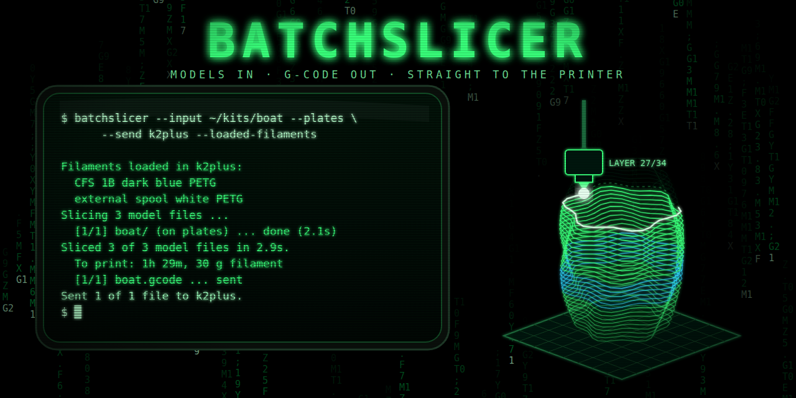

# BatchSlicer



[](https://pypi.org/project/batchslicer/)
[](https://pypi.org/project/batchslicer/)
[](https://github.com/drak42/batch_slicer/actions/workflows/ci.yml)
[](https://github.com/drak42/batch_slicer/blob/main/LICENSE)
[](https://buymeacoffee.com/drak42)

Slice one 3D model or whole folders of them with **OrcaSlicer**, **Creality
Print** or **Bambu Studio**, using the printer, filament and process presets
you already have in those slicers, on Linux, Windows or macOS. Run it interactively and answer a few
questions, or pass everything on the command line for unattended, scripted runs.
It can put a kit's parts together on plates, make several copies of a part,
adds preview pictures for printer screens, and can send the G-code straight to
a Klipper or OctoPrint printer.

BatchSlicer exists to remove friction from the 3D printing workflow through
reliable, maintainable automation. Batch slicing is the first step towards a
dependable automation platform that helps makers, professionals and print
farms spend less time managing printers and more time creating.

## Quick start

```bash
pipx install batchslicer                         # from PyPI
batchslicer setup                                # find your slicers, write the configuration
cp ~/Downloads/*.stl ~/BatchSlicer/incoming/     # put some models where BatchSlicer looks
batchslicer                                      # answer a few questions, get G-code
```

Results appear in `~/BatchSlicer/output`. Next time, `batchslicer --last`
repeats the same run.

The same four commands work on Linux, Windows (PowerShell) and macOS
(Terminal). Need Python or pipx first? See [Installation](#installation),
which has the steps for each system.

New to BatchSlicer? The **[User Guide](docs/UserGuide.md)** walks through
everything step by step: installing, your first slice, profiles, folders and
kits, sending to a printer, multi-colour and the CFS, and the watch folder.
This README is the full reference.

### See it in action


A dry run, then a two-colour project matched to the spools loaded in a
Creality CFS and sent to the printer, then a downloaded kit's zip unpacked
onto one plate. Recorded with [`docs/demo/demo.sh`](https://github.com/drak42/batch_slicer/blob/main/docs/demo/demo.sh).

---

## Contents

- [User Guide](docs/UserGuide.md) (step by step, separate page)
- [What it does](#what-it-does)
- [How it works](#how-it-works)
- [Requirements](#requirements)
- [Installation](#installation): [Linux](#installing-on-linux), [Windows](#installing-on-windows), [macOS](#installing-on-macos)
- [Configuration](#configuration) (including [where BatchSlicer keeps things](#where-batchslicer-keeps-things))
- [Using BatchSlicer interactively](#using-batchslicer-interactively)
- [Using the command line](#using-the-command-line)
- [Profiles](#profiles)
- [Slicing for several printers](#slicing-for-several-printers)
- [Sending G-code to a printer](#sending-g-code-to-a-printer)
- [Watch folder](#watch-folder) (including [the web page](#following-it-in-a-web-page))
- [Multi-colour projects](#multi-colour-projects)
- [Output](#output) (including [several models per plate](#several-models-per-plate), [reports](#reports) and [speed](#speed))
- [Exit status and logs](#exit-status-and-logs)
- [Troubleshooting](#troubleshooting)
- [Checking your setup: `batchslicer doctor`](#checking-your-setup-batchslicer-doctor)
- [Testing](#testing)
- [Current limitations](#current-limitations)
- [Support](#support)

---

## What it does

- **Works with the slicer you already use.** OrcaSlicer, Creality Print and
  Bambu Studio are supported, driven through their own command-line slicing.
- **Uses your presets.** Choose a printer, then a compatible filament and
  process, from the same lists the slicer shows. Presets you created or edited
  yourself are listed first and marked `(mine)`.
- **Slices one file or a whole folder tree.** Point it at a folder and every
  `.stl`, `.3mf` and `.obj` model in it and its subfolders is sliced, with
  progress shown per file. `--exclude` leaves out folders or files you do not
  want, such as old versions or meshes bundled with other software.
- **Puts small parts together on plates.** When slicing a folder, the parts in
  each folder (a kit, say) can be arranged on as few plates as fit, giving one
  G-code file per plate instead of one print per part.
- **Makes copies.** Slicing a single part, ask for any number of copies; the
  slicer arranges them, adding plates when they don't fit on one.
- **Keeps your file names.** `bracket.stl` becomes `bracket.gcode`, and a batch
  mirrors your folder structure (or, with `--flat`, puts all its G-code in one
  folder).
- **Never overwrites earlier results.** Every run gets its own time-stamped
  folder, which also records the exact presets that were used.
- **Slices downloaded kits as they are.** A `.zip` from a model site can be
  given with `--input` or dropped into the watch folder: its models are
  unpacked safely and sliced like a folder.
- **Shows what it will do first.** `--dry-run` lists every model, plate,
  filament and destination without slicing or sending anything.
- **Explains failures.** A model that fails does not stop the batch; the
  summary lists each failure with the slicer's own reason, and suggests an
  option when one may fix it.
- **Rescues awkwardly saved models.** With `--orient retry`, a model the slicer
  rejects is sliced again with the slicer's auto-orient. In a test on 1,719
  downloaded models this fixed 97 of 115 "Failed slicing the model" errors.
- **Adds preview pictures for printer screens.** Slicers draw these only in
  their windows, so BatchSlicer draws them from the G-code itself: the part as
  it will print, in the filament's colour, or in each filament's colour for a
  multi-colour print.
- **Handles multi-colour projects.** A 3MF project painted in several colours
  is sliced with a filament for every colour: yours in every slot, one chosen
  per slot, or matched to the filaments loaded in your Creality CFS. STL kits
  can print in several colours too, with `--slot`.
- **Reports print time and filament.** Every run writes `report.csv` and
  `report.json` with each model's status, print time, filament weight, length
  and cost, and the summary shows the totals.
- **Can slice several models at once.** `--jobs N` runs N slicers side by
  side, which helps most on computers with many cores (see [Speed](#speed)).
- **Slices for several printers at once.** One run can slice the same models
  for different printers, each with its own slicer and presets, into separate
  folders.
- **Sends the G-code to your printer.** With `--send`, the G-code goes straight
  to a Klipper printer (Moonraker) or an OctoPrint server over the network,
  keeping the folder structure; `--start` starts printing a single model.
- **Remembers your choices.** Save a run as a named profile, or repeat the last
  run with `--last`.
- **Runs unattended.** Every choice can be given as a command-line option or a
  profile, so it can be scripted or scheduled. With `--watch` it keeps running
  and slices every model or folder you drop into a folder.
- **Leaves your slicers alone.** BatchSlicer only reads the slicers' settings
  folders; it never changes them.

| Slicer | Slicing | Preset selection | Several models per plate, copies |
|---|---|---|---|
| OrcaSlicer (tested with 2.4 and 2.5) | Yes | Yes | Yes |
| Creality Print (tested with 7.3) | Yes | Yes | No (no command-line arrange or copies) |
| Bambu Studio (tested with 2.8 and 2.9) | Yes | Yes | Yes |

## How it works

A run goes through these steps. Each choice comes from the command line or a
profile if you gave it there, and is asked for otherwise.

1. **Start from a profile (optional).** If you have saved profiles and gave no
   options, BatchSlicer offers them first; Enter skips this.
2. **Choose a slicer.** Only slicers set up in the configuration can be
   chosen.
3. **Check the environment.** The Python version, the configuration, the
   working folders and the chosen slicer's program and data folder are checked.
   If anything is wrong, each problem is listed and BatchSlicer stops.
4. **Choose presets: printer, filament, process.**
   - Printers are the ones you have added in the slicer, plus printer presets
     you saved yourself.
   - Filaments and processes are limited to those compatible with the chosen
     printer. Built-in filaments are limited to those you have made visible in
     the slicer, so the lists match the slicer's own menus.
5. **Add another printer (optional).** Repeat steps 2 to 4 for each extra
   printer to slice for.
6. **Choose what to slice:** one model file, every model in a folder and its
   subfolders, or (with `--input`) a zip file, whose models are unpacked first.
   For a folder whose subfolders hold several loose models, BatchSlicer asks
   whether to put each folder's models together on plates; for a single
   model, it asks how many copies to make.
7. **Send to a printer (optional).** If a printer is configured or the last
   run sent to one, BatchSlicer asks whether to send the G-code there. It
   checks that the printer answers before slicing anything.
8. **Fill the filament slots (multi-colour projects only).** BatchSlicer asks
   whether to match the colours to the filaments loaded in the printer's CFS,
   use your filament in every slot, or choose one per slot.
9. **Choose the output folder.** With `--dry-run`, BatchSlicer stops here and
   shows what it would do.
10. **Slice.** BatchSlicer runs the slicer's command-line mode for each model
   (or each folder of models on plates, and each printer), collects the
   G-code, and adds preview pictures to it. The run's choices are saved as the
   profile `last`.
11. **Report and send.** The summary shows print time and filament, a report
    is written, and the G-code goes to the printer if you chose one.

**Why preset files are prepared first.** Presets saved in a slicer usually store
only the settings that differ from the preset they are based on, and the
slicers' command-line mode cannot use them in that form. BatchSlicer combines
each chosen preset with everything it inherits from into a complete file, saves
those files with the job, and passes them to the slicer.

**OrcaSlicer's built-in presets.** OrcaSlicer 2.4 and later keep their
built-in presets in packed `.opc` files. BatchSlicer takes the vendors you use
(for example Creality) from the OrcaSlicer program itself (2.4 ships them as
plain files, 2.5 as `.opc` files, which BatchSlicer reads), or from the `.opc`
files in OrcaSlicer's settings folder for vendors the program does not ship.
They are unpacked once into the `slicer-profiles` folder of BatchSlicer's
working cache (see [Where BatchSlicer keeps things](#where-batchslicer-keeps-things)),
and again automatically when OrcaSlicer or those files change. This usually
takes about a second; on Windows the first time can take a minute or two.

## Requirements

- **Linux, Windows 10 or 11, or macOS**, with **Python 3.12 or newer**.
- **At least one slicer**: OrcaSlicer, Creality Print or Bambu Studio,
  **opened at least once** so it has created its settings folder and you have
  added your printers in it. How it is installed depends on the system:
  AppImages (or a regular install) on Linux, the slicers' installers (or
  portable copies) on Windows, the apps in Applications on macOS.
- Optional, for sending G-code: a printer running Klipper with Moonraker (such
  as the Creality K1 and K2 series), or OctoPrint, on your network.

## Installation

BatchSlicer is installed with [pipx](https://pipx.pypa.io/), which keeps it in
its own environment and puts the `batchslicer` command on your PATH. The steps
for each system are below; after them, every command in this README works the
same everywhere.

### Installing on Linux

```bash
sudo apt install pipx            # Debian, Ubuntu, Mint; see the pipx site for others
pipx ensurepath                  # then open a new terminal
pipx install batchslicer
batchslicer setup
```

(`python3 -m pip install --user batchslicer` works too.)

### Installing on Windows

1. Install Python 3.12 or newer from
   [python.org](https://www.python.org/downloads/windows/), or with
   `winget install Python.Python.3.13`.
2. In PowerShell, install pipx, then open a **new** PowerShell window:

   ```powershell
   py -m pip install --user pipx
   py -m pipx ensurepath
   ```

3. Install BatchSlicer and let it find your slicers:

   ```powershell
   pipx install batchslicer
   batchslicer setup
   ```

Use PowerShell or Command Prompt, with Windows paths
(`C:\Users\you\Models`) where this README shows Linux ones.

### Installing on macOS

1. Install Python 3.12 or newer from
   [python.org](https://www.python.org/downloads/macos/), or with Homebrew
   (`brew install python`). The `python3` that comes with macOS is too old.
2. In Terminal, install pipx, then open a **new** Terminal window:

   ```bash
   python3 -m pip install --user pipx
   python3 -m pipx ensurepath
   ```

   With Homebrew, `brew install pipx` does both.

3. Install BatchSlicer and let it find your slicers:

   ```bash
   pipx install batchslicer
   batchslicer setup
   ```

### Upgrading

`pipx upgrade batchslicer`, on every system.

### From a release file

Each [GitHub release](https://github.com/drak42/batch_slicer/releases) also
has the `.whl` file attached, for installing without PyPI:

```bash
pipx install ./batchslicer-*-py3-none-any.whl
```

### From source (for development)

From a copy of this repository:

```bash
python3 -m venv .venv
.venv/bin/pip install -e '.[dev,web]'
```

This installs BatchSlicer into `.venv` together with the web page's
libraries and the test and lint tools.
Run it as `.venv/bin/batchslicer` (or activate the environment with
`source .venv/bin/activate`); the examples below just say `batchslicer`.

### First run

Let BatchSlicer find your slicers and create its configuration:

```bash
batchslicer setup
```

## Configuration

### Setting up with `batchslicer setup`

`setup` finds your slicers, shows what it found, and recommends the newest
stable version of each:

```
OrcaSlicer:
  1) ~/Apps/OrcaSlicer_Linux_AppImage_Ubuntu2404_V2.5.2.AppImage  (version 2.5.2, recommended)
  2) ~/Apps/OrcaSlicer_Linux_AppImage_Ubuntu2404_V2.4.0.AppImage  (version 2.4.0)
  3) ~/Downloads/OrcaSlicer_Linux_AppImage_Ubuntu2404_V2.6.0-beta.AppImage  (version 2.6.0, pre-release)
  4) Don't use OrcaSlicer
Enter for 1, or a number 1-4:
```

Press Enter for the recommendation, pick another version, or skip the slicer.
Setup also finds each slicer's settings folder (for Creality Print, the one
it uses now). A slicer that has never been opened is skipped with a note: open
it once, add your printers, and run setup again.

Setup writes the configuration file and creates the `incoming` and `output`
folders (see [Where BatchSlicer keeps things](#where-batchslicer-keeps-things)).
If a configuration already exists it asks before replacing it and keeps the
old one as `config.yaml.bak`.

| Option | Meaning |
|---|---|
| `--config PATH` | write the configuration somewhere else |
| `--no-prompt` | accept the recommended version of each slicer without asking |
| `--force` | replace an existing configuration (needed with `--no-prompt`) |

**Where setup looks for slicers:**

- **Linux**: AppImages in `~/Apps`, `~/Applications`, `~/AppImages`,
  `~/Downloads`, `~/Desktop` and `~/.local/bin` (and one folder below each),
  in `/opt`, and slicer programs on your PATH. The version comes from the file
  name. Flatpak installs are not detected; point the configuration at the
  slicer program yourself if you use one.
- **Windows**: `Program Files`, `Program Files (x86)` and
  `%LOCALAPPDATA%\Programs` (where the slicers' installers put them), and
  portable copies in `Downloads`, `Desktop` and the other folders above (up to
  two folders deep). The version comes from Windows' list of installed
  programs.
- **macOS**: `OrcaSlicer.app`, `BambuStudio.app` and `Creality Print.app` in
  `/Applications` and `~/Applications`. Setup uses the program inside the app
  (`Contents/MacOS`) and reads the version from the app's `Info.plist`.

### Where the configuration lives

BatchSlicer uses the first of these that applies:

1. the file given with `--config PATH`
2. the file named by the `BATCHSLICER_CONFIG` environment variable
3. `config/config.yaml` in the current folder (handy when working in a copy of
   this project)
4. the standard configuration file for your system, where `setup` writes it
   (see the next section)

### Where BatchSlicer keeps things

The defaults for each system. The five `paths` settings in the configuration
(`incoming`, `output`, `logs`, `data`, `profiles`) move them, and an `XDG_*`
environment variable, when set, moves the matching folder on every system.

**Linux**

| What | Where |
|---|---|
| Configuration | `~/.config/batchslicer/config.yaml` |
| Models to slice (`incoming`), results (`output`) | `~/BatchSlicer/incoming`, `~/BatchSlicer/output` |
| Logs (`logs`) | `~/.local/state/batchslicer` |
| Working cache (`data`) | `~/.cache/batchslicer` |
| Saved profiles (`profiles`) | `~/.local/share/batchslicer/profiles.yaml` |
| Slicer settings (`datadir`) | `~/.config/OrcaSlicer`, `~/.config/BambuStudio`, `~/.config/Creality/Creality Print/<version>` |

**Windows**

| What | Where |
|---|---|
| Configuration | `%APPDATA%\BatchSlicer\config.yaml` |
| Models to slice, results | `%USERPROFILE%\BatchSlicer\incoming`, `%USERPROFILE%\BatchSlicer\output` |
| Logs | `%LOCALAPPDATA%\BatchSlicer\logs` |
| Working cache | `%LOCALAPPDATA%\BatchSlicer\cache` |
| Saved profiles | `%APPDATA%\BatchSlicer\profiles.yaml` |
| Slicer settings | `%APPDATA%\OrcaSlicer`, `%APPDATA%\BambuStudio`, `%APPDATA%\Creality\Creality Print\<version>` |

**macOS**

| What | Where |
|---|---|
| Configuration | `~/Library/Application Support/BatchSlicer/config.yaml` |
| Models to slice, results | `~/BatchSlicer/incoming`, `~/BatchSlicer/output` |
| Logs | `~/Library/Logs/BatchSlicer` |
| Working cache | `~/Library/Caches/BatchSlicer` |
| Saved profiles | `~/Library/Application Support/BatchSlicer/profiles.yaml` |
| Slicer settings | `~/Library/Application Support/OrcaSlicer`, `.../BambuStudio`, `.../Creality/Creality Print/<version>` |

`batchslicer doctor` shows the folders in use on your computer.

### Editing it by hand

`config/config.example.yaml` is a commented template. Each slicer you use needs
two paths; leave both empty for a slicer you do not use:

- `executable`: the slicer program. On Linux its AppImage, or just a program
  name such as `orca-slicer` if it is on your PATH; on Windows the `.exe`; on
  macOS the program inside the app, such as
  `/Applications/OrcaSlicer.app/Contents/MacOS/OrcaSlicer`.
- `datadir`: the folder where the slicer keeps its settings and presets (see
  the tables above).

```yaml
orca:
  executable: "~/Apps/OrcaSlicer_Linux_AppImage_Ubuntu2404_V2.5.2.AppImage"
  datadir: "~/.config/OrcaSlicer"

creality_print:
  executable: "~/Apps/CrealityPrint-V7.3.0.6157-x86_64-Release.AppImage"
  datadir: "~/.config/Creality/Creality Print/7.3"

bambu_studio:
  executable: "~/Apps/BambuStudio_ubu24-v02.09.01.70-20261103183404.AppImage"
  datadir: "~/.config/BambuStudio"

paths:              # all optional; empty means the default for your system
  incoming: ""      # models offered for slicing
  output: ""        # default output folder
  logs: ""          # log files
  data: ""          # BatchSlicer's working cache
  profiles: ""      # saved profiles file

printers:           # optional: printers for --send (see "Sending G-code to a printer")
  k2plus:
    url: "http://192.168.1.50:7125"
    api_key: ""     # only if Moonraker asks for one
  ender3:           # an OctoPrint server
    type: octoprint
    url: "http://octopi.local"
    api_key: "..."  # OctoPrint always needs one
```

Paths may start with `~` for your home folder. Relative paths are relative to
the folder the configuration file is in, so BatchSlicer behaves the same
whichever folder you run it from. Folders are created when needed.

**Windows paths** are written with forward slashes, as setup does
(`"C:/Program Files/OrcaSlicer/orca-slicer.exe"`); Windows accepts them.
Inside double quotes a backslash starts an escape (`"C:\Program Files"` is an
error, and BatchSlicer says so), so a path with backslashes goes in single
quotes: `'C:\Program Files\OrcaSlicer\orca-slicer.exe'`.

## Using BatchSlicer interactively

Put the models you want to slice in your incoming folder
(`~/BatchSlicer/incoming` by default; subfolders are fine), then run:

```bash
batchslicer
```

BatchSlicer asks one question at a time. If you have saved profiles, it first
offers them (press Enter to skip):

```
Start from a saved profile?
  1) last run: creality_print, Creality K2 Plus 0.4 nozzle, ...
  2) k2-petg: creality_print, Creality K2 Plus 0.4 nozzle, ...
Profile number 1-2, or Enter to choose everything yourself:
```

Otherwise it starts with the slicer and presets:

```
Select a slicer:
  1) OrcaSlicer
  2) Creality Print
  3) Bambu Studio  (not configured)
Enter 1-3: 2

Select a printer:
  1) Creality Ender-3 V3 SE 0.4 nozzle
  2) Creality K2 Plus 0.4 nozzle
Printer number, or text to search: 2

Select a filament:
  1) Sliced PETG @Creality K2 Plus 0.4 nozzle  (mine)
  2) CR-PETG @Creality K2 Plus 0.4 nozzle
  ...
Filament number, or text to search: petg
```

How the menus work:

- **Type a number** to pick that entry.
- **Type text** to show only entries containing it (`petg`, `0.12`, `k2`), then
  pick by number from the shorter list. **Press Enter** to show everything
  again.
- **Ctrl+C** (or Ctrl+D) at any question stops BatchSlicer without slicing
  anything.

After the presets, BatchSlicer asks `Slice for another printer as well? [y/N]`.
Press Enter to continue with one printer, or `y` to add another (see
[Slicing for several printers](#slicing-for-several-printers)).

Then you choose what to slice:

```
What would you like to slice?
  1) One model file
  2) Every model in a folder (including subfolders)
```

- **One model file** lists the models in the incoming folder and its subfolders
  (shown as `brackets/left.stl`). You can also type the path to a model
  anywhere else.
- **Every model in a folder** lists the incoming folder and every folder beneath it that
  contains models, with a count for each. You can also type any folder path.
  BatchSlicer shows how many files it found and asks you to confirm.

When you slice a folder whose subfolders hold several loose models (STL, OBJ
or STEP files), BatchSlicer asks whether to put them together on plates (see
[Several models per plate](#several-models-per-plate)):

```
Put the models in each folder together on plates? (8 models in 1 folder could share plates; 3MF projects keep their own) [y/N]
```

Enter keeps what the last run did. The question is skipped with `--plates` or
`--no-plates`, for runs from a profile, and for Creality Print (which cannot
arrange from its command line).

When you slice a single STL, OBJ or STEP model, BatchSlicer asks how many
copies to make (see [Copies](#copies)):

```
How many copies of bracket.stl? (Enter for 1):
```

It is skipped with `--copies`, for runs from a profile, for 3MF projects, and
for Creality Print.

Then, if you have a printer to send to (one in the configuration's `printers`
section, or the one the last run sent to), BatchSlicer asks whether to send
the G-code there (see [Sending G-code to a printer](#sending-g-code-to-a-printer)):

```
Send the G-code to a printer?
  0) Don't send
  1) k2plus (http://192.168.1.242:7125)  (last time)
  Or type another printer's address, such as 192.168.1.50
Enter for 1, a number 0-1, or an address:
```

Enter keeps what the last run did. If you have never sent to a printer, this
question is not asked. It is also skipped when the run comes from a profile
or `--last` (the profile decides), with `--send` or `--no-send`, and for runs
that slice for several printers.

When what you chose to slice holds a multi-colour 3MF project, BatchSlicer
then lists its filaments and asks how to fill them (see [Multi-colour
projects](#multi-colour-projects)):

```
bumper.3mf lists 2 filaments:
  slot 1: black PETG
  slot 2: white PETG
How should the filament slots be filled?
  1) Match them to the filaments loaded in k2plus (CFS 1B dark blue PETG, CFS 1C light grey PETG, external spool white PETG)
  2) Use Generic PETG @K2 Plus-all in every slot
  3) Choose a filament for each slot
Number:
```

The first way is offered only when the printer you send to reports loaded
filaments. The question is skipped for runs from a profile, and with
`--filament` or `--loaded-filaments` (or their `--no-` forms).

Last, the output folder:

```
Select an output folder:
  1) output  (default)
  2) output/k2-batch
Folder number, a new folder name or path, or Enter for the default:
```

Press Enter for the default, pick an existing folder by number, or type a new
name (created inside the output folder) or a full path (used as typed). BatchSlicer asks
before creating a folder.

## Using the command line

Every question has a matching option. Options you give are used without
asking; anything you leave out is still asked for, unless you add
`--no-prompt`.

| Option | Meaning |
|---|---|
| `--slicer NAME` | `orca`, `creality` or `bambu` (full names such as `"Creality Print"` also work) |
| `--printer NAME` | printer preset name |
| `--filament NAME` | filament preset name (must suit the printer); repeat it for the slots of a multi-colour print, slot 1 first (see [Multi-colour projects](#multi-colour-projects)) |
| `--slot PATTERN=SLOT` | print STL, OBJ and STEP models matching PATTERN with filament SLOT: a number, or with `--loaded-filaments` a loaded filament such as `1B` or `external`; repeatable (see [Colours for STL files](#colours-for-stl-files)) |
| `--process NAME` | process (print settings) preset name (must suit the printer) |
| `--input PATH` | a model file, a folder (every model in it and its subfolders is sliced, without asking for confirmation), or a zip file such as a downloaded kit (its models are unpacked to a temporary folder and sliced like a folder; `--last` remembers the zip) |
| `--output PATH` | output folder; created if missing; defaults to the configured `output` folder |
| `--no-prompt` | never ask anything; a missing choice is an error that names the option to add |
| `--orient MODE` | the slicer's auto-orient: `off` (default), `retry` (slice a model that fails once more with auto-orient) or `always` (auto-orient every model; this may rotate parts saved the right way up). Not available for Creality Print |
| `--allow-newer-files` | let the slicer open `.3mf` projects saved by a newer slicer version (`--no-allow-newer-files` turns off a profile's setting) |
| `--jobs N` | slice N models at the same time (default 1); see [Speed](#speed) |
| `--plates` | when slicing a folder, put the loose models of each folder together on as few plates as fit (see [Several models per plate](#several-models-per-plate)); `--no-plates` slices each model on its own |
| `--copies N` | slice N copies of a single STL, OBJ or STEP model, arranged on as many plates as needed (see [Copies](#copies)); not for folders or 3MF projects |
| `--flat` | put all of a batch's G-code in one folder, here and on the printer (see [Output](#output)); `--no-flat` turns it off over a profile |
| `--no-thumbnails` | don't add preview pictures to the G-code (see [Output](#output)); `--thumbnails` turns them back on over a profile |
| `--exclude PATTERN` | leave out folders or files matching PATTERN when slicing a folder; repeat for several (see [Leaving models out](#leaving-models-out)) |
| `--send PRINTER` | after slicing, upload the G-code to PRINTER: its address (`192.168.1.50`, `k2.local:4408` or a full URL) or a name from the configuration's `printers` section (see [Sending G-code to a printer](#sending-g-code-to-a-printer)); `--no-send` turns off a profile's printer |
| `--loaded-filaments` | match multi-colour projects (and `--slot` names such as `1B`) to the filaments loaded in the `--send` printer's CFS; `--no-loaded-filaments` turns it off over a profile |
| `--watch` | keep running and slice every model or folder dropped into the input folder (see [Watch folder](#watch-folder)) |
| `--start` | start printing once the G-code is on the printer; only for a single model that gives one G-code file |
| `--dry-run` | show what the run would do (models, plates, copies, filament slots and CFS matches, where results would go and be sent) without slicing, writing or sending anything; choices are not remembered |
| `--list-presets` | list preset names, then exit (see below) |
| `--profile NAME` | start from a saved profile (see [Profiles](#profiles)); repeat it to slice for several printers |
| `--last` | repeat the last run |
| `--save-profile NAME` | save this run's choices as a profile |
| `--list-profiles`, `--delete-profile NAME` | list or delete saved profiles |
| `--config PATH` | use a specific configuration file |
| `--help`, `--version` | show help or the version |

Preset names must match the slicer's name exactly, except that upper/lower case
does not matter. Put names containing spaces or `@` in quotes.

### Finding preset names

```bash
# printers for a slicer
batchslicer --slicer creality --list-presets

# filaments and processes for one printer
batchslicer --slicer creality --printer "Creality K2 Plus 0.4 nozzle" --list-presets
```

If you mistype a name, BatchSlicer suggests the closest matches:

```
BatchSlicer startup failed: No filament preset named 'Generic PTEG @Creality K2 Plus 0.4 nozzle'
compatible with Creality K2 Plus 0.4 nozzle. Did you mean: 'Generic PETG @Creality K2 Plus 0.4 nozzle'; ...?
```

### Examples

Slice a whole folder, fully unattended:

```bash
batchslicer --slicer creality \
  --printer "Creality K2 Plus 0.4 nozzle" \
  --filament "Generic PETG @Creality K2 Plus 0.4 nozzle" \
  --process "0.20mm Standard @Creality K2 Plus 0.4 nozzle" \
  --input ~/BatchSlicer/incoming/brackets \
  --output ~/BatchSlicer/output/k2-petg \
  --no-prompt
```

Slice one file with OrcaSlicer into the default output folder:

```bash
batchslicer --slicer orca \
  --printer "Creality K2 Plus 0.4 nozzle" \
  --filament "Generic PLA @System" \
  --process "0.20mm Standard @Creality K2 Plus 0.4 nozzle" \
  --input ~/models/bracket.stl --no-prompt
```

A large batch, two models at a time, rescuing models the slicer rejects and
leaving out the printer-bed meshes that come with Cura:

```bash
batchslicer --profile k2-pla --input ~/Downloads \
  --exclude "Cura-*" --orient retry --allow-newer-files --jobs 2 --no-prompt
```

A folder of kits, each kit's parts together on plates, sent to the printer:

```bash
batchslicer --profile k2-pla --input ~/BatchSlicer/incoming/kits   --plates --send 192.168.1.242 --no-prompt
```

Six copies of a bracket:

```bash
batchslicer --profile k2-pla --input ~/models/bracket.stl --copies 6 --no-prompt
```

One model, sent to the printer and started:

```bash
batchslicer --profile k2-pla --input ~/models/bracket.stl --send 192.168.1.242 --start
```

### Leaving models out

`--exclude PATTERN` leaves out models when slicing a folder. Repeat it for
several patterns.

| Pattern | Leaves out |
|---|---|
| `Cura-*` | every folder (or file) whose name starts with `Cura-`, at any depth |
| `old` | every folder named `old`, wherever it is |
| `*_v1.stl` | files ending in `_v1.stl`, in any folder |
| `kits/old` | only the `old` folder inside `kits`, within the folder being sliced |
| `*/supports/*` | anything inside a `supports` folder one or more levels down |

- A pattern without `/` matches any single folder or file name; a pattern with
  `/` matches a path inside the folder being sliced.
- `*`, `?` and `[...]` work as in the shell, and upper/lower case is ignored.
  Quote patterns so the shell does not expand them.
- BatchSlicer says how many model files it skipped. If every model matches, it
  stops without slicing.
- A single model file chosen explicitly is always sliced.
- Hidden folders (names starting with `.`) are always skipped.

Set the slicer and printer, and be asked for everything else:

```bash
batchslicer --slicer orca --printer "Creality K2 Plus 0.4 nozzle"
```

Run on a schedule (for example from cron). Save the choices as a profile once,
then run it unattended. Cron has a minimal PATH, so give the full path to
`batchslicer` (`command -v batchslicer` shows it), and `--config` if the
configuration is not in `~/.config/batchslicer/`:

```bash
# crontab -e: slice everything in incoming at 02:00 every night
0 2 * * * $HOME/.local/bin/batchslicer --profile nightly --no-prompt >> $HOME/batchslicer-cron.txt 2>&1
```

## Profiles

A profile is a named set of choices (slicer, printer, filament (or one per
slot), process, input and output, plus `--orient`, `--allow-newer-files`,
`--jobs`, `--exclude`, `--plates`, `--copies`, `--thumbnails`, `--flat`,
`--slot`, `--loaded-filaments` and `--send` if you gave them; `--start` and
`--watch` are never saved) that you can reuse instead of typing them again. Options you
add override the profile's; for `--exclude`, the patterns you give replace the
profile's list.

```bash
# slice as usual and save the choices under a name
batchslicer --slicer creality --printer "Creality K2 Plus 0.4 nozzle" \
  --filament "Generic PETG @Creality K2 Plus 0.4 nozzle" \
  --process "0.20mm Standard @Creality K2 Plus 0.4 nozzle" \
  --input ~/BatchSlicer/incoming/brackets --save-profile k2-petg

# reuse it; any option you add overrides the profile's choice
batchslicer --profile k2-petg --no-prompt
batchslicer --profile k2-petg --input ~/BatchSlicer/incoming/wheels --no-prompt

# repeat the last run exactly
batchslicer --last --no-prompt

batchslicer --list-profiles
batchslicer --delete-profile k2-petg
```

- Every run's choices are saved automatically as the profile `last`, which
  `--last` repeats.
- When you start `batchslicer` with no options and have saved profiles, it
  first offers them; press Enter to choose everything yourself instead.
- Profile names match ignoring case and may contain letters, digits, spaces,
  dots, dashes and underscores.
- Profiles are kept in `~/.local/share/batchslicer/profiles.yaml` (set
  `paths.profiles` in the configuration to move it). It is plain YAML and can
  be edited by hand.

## Slicing for several printers

One run can slice the same models for more than one printer, each with its own
slicer, filament and process.

**Interactively**, after choosing the presets BatchSlicer asks:

```
Slice for another printer as well? [y/N]
```

Answer `y` to choose another slicer and printer; repeat as often as you like.

**On the command line**, save each printer as a profile and list them:

```bash
batchslicer --profile k2-petg --profile ender-pla \
  --input ~/BatchSlicer/incoming/brackets --no-prompt
```

- Each printer's results go into its own subfolder of the output folder, named
  after the printer (with the slicer's name added if the same printer is used
  with two slicers, and a number if it is used twice with one slicer):

  ```
  output/
    Creality K2 Plus 0.4 nozzle/brackets-20261120-161654/...
    Creality Ender-3 V3 SE 0.4 nozzle/brackets-20261120-161720/...
  ```

- Printers are sliced one after another; a failure for one does not stop the
  others, and a summary at the end lists each printer as ok or FAILED.
  Ctrl+C stops the current printer and skips the rest.
- `--save-profile` saves all the printers as one profile, and `--last` repeats
  the whole run.
- `--slicer`, `--printer`, `--filament` and `--process` describe a single
  printer, so they cannot be combined with several; use one profile per
  printer instead.

In the profiles file, a profile for several printers lists them under
`targets`:

```yaml
k2-and-ender:
  targets:
  - slicer: creality_print
    printer: Creality K2 Plus 0.4 nozzle
    filament: Generic PETG @Creality K2 Plus 0.4 nozzle
    process: 0.20mm Standard @Creality K2 Plus 0.4 nozzle
    send: 192.168.1.242          # optional: this printer's G-code is sent here
  - slicer: orca
    printer: Creality Ender-3 V3 SE 0.4 nozzle
    filament: Generic PLA @System
    process: 0.20mm Standard @Creality Ender3V3SE 0.4
  input: ~/BatchSlicer/incoming/brackets
```

## Sending G-code to a printer

BatchSlicer can upload the G-code to a printer running Klipper with
Moonraker, its web interface (the Creality K1 and K2 series, Voron and many
others), or to an OctoPrint server ([see below](#octoprint)). For a Klipper
printer, give its address directly:

```bash
batchslicer --profile k2-pla --input ~/BatchSlicer/incoming/kit --send 192.168.1.50
batchslicer --profile k2-pla --input ~/BatchSlicer/incoming/kit --send 192.168.1.50:4408
```

An address without a port uses Moonraker's usual port 7125; `k2.local` and
full URLs such as `http://192.168.1.50:7125` work too. Nothing needs to be set
up first.

Or name each printer once in the configuration, which also lets you set an
API key, and use the name:

```yaml
printers:
  k2plus:
    url: "http://192.168.1.50:7125"   # the printer's address and Moonraker's port
    api_key: ""                       # only if Moonraker asks for one
```

The address is the one you open in a browser for Fluidd or Mainsail, or the
one in your slicer's "physical printer" or "send to printer" settings.

**Keeping the key out of the file.** Instead of `api_key`, give
`api_key_env` the name of an environment variable that holds the key; useful
with systemd credentials, a secret manager, or a configuration file you
share:

```yaml
printers:
  k2plus:
    url: "http://192.168.1.50:7125"
    api_key_env: MOONRAKER_API_KEY    # the key is read from this variable
```

Set one of the two, not both. If the variable is not set when BatchSlicer
runs, it says which one is missing; `batchslicer doctor` shows where each
printer's key came from, never the key itself. Then:

```bash
# slice a folder and put the results on the printer
batchslicer --profile k2-pla --input ~/BatchSlicer/incoming/kit --send k2plus

# slice one model and start printing it
batchslicer --profile k2-pla --input bracket.stl --send k2plus --start
```

- Before slicing, BatchSlicer checks that the printer answers, so a long
  batch doesn't run only to find the printer switched off.
- The files go into the printer's G-code folder. A batch keeps its folder
  structure inside a folder named like the batch
  (`kit-20261122-073000/arms/left.gcode`), and a single model goes to the top
  folder. A file already on the printer with the same name is replaced.
- Only models that sliced are sent. A file the printer refuses is listed,
  and makes the run end with status 1.
- `--start` works for one model that gives one G-code file. If the printer is
  busy or not ready, the file stays on it without starting (or joins
  Moonraker's job queue, if that is on).
- A profile remembers the printer (`--send`), but never `--start`, so a saved
  profile cannot start prints by itself. `--no-send` skips sending for one run.
- With several printers, each profile sends to its own printer.
- In an interactive run, BatchSlicer asks whether to send (see
  [Using BatchSlicer interactively](#using-batchslicer-interactively)), and
  offers the printer used last time as the default.
- `batchslicer doctor` checks that every configured printer answers.
- **Creality K2 Plus** (tested): Moonraker answers on port 7125 and on 4408,
  with no API key needed, and the touchscreen shows the batch folders and
  BatchSlicer's preview pictures. Creality Print's device list shows the
  printer's address. When a file is replaced under the same name, the screen
  may keep showing the old picture (or none); in testing, sending the file
  again fixed it.

### OctoPrint

OctoPrint always asks for an API key, so name the printer in the
configuration with `type: octoprint`. Create the key in OctoPrint under
**Settings > Application Keys** (or use the global key under **Settings >
API**):

```yaml
printers:
  ender3:
    type: octoprint
    url: "http://octopi.local"     # the address you open OctoPrint at
    api_key: "paste the key here"
```

```bash
batchslicer --profile ender-pla --input ~/BatchSlicer/incoming/kit --send ender3
```

Everything above applies, with these differences:

- The files go into OctoPrint's uploads, in the same folders; missing folders
  are created.
- `--start` selects and prints the file when the printer is connected and
  idle ("Operational"). Otherwise the file stays in OctoPrint without
  starting. A file that is printing right now cannot be replaced; that upload
  fails with OctoPrint's message.
- An address given directly to `--send` (such as `--send 192.168.1.60`) is
  always treated as Moonraker; use a configured name for OctoPrint.
- OctoPrint shows the preview pictures only with a plugin that reads them
  from the G-code, such as "Slicer Thumbnails".
- **Tested with OctoPrint 2.0.1** (a Creality Ender-3 V3 SE on a serial
  port): `batchslicer doctor` reads its state, a batch's nested folders are
  created, names with spaces come through, sending a file again replaces it,
  and `--start` selects and prints a single file.

## Watch folder

With `--watch`, BatchSlicer keeps running and slices whatever you put in a
folder: drop models in, get G-code out (and onto the printer, with `--send`).

```bash
# watch the incoming folder (~/BatchSlicer/incoming), slice for the k2-pla profile
batchslicer --profile k2-pla --watch

# watch another folder, put each kit on plates and send the results to the printer
batchslicer --profile k2-pla --input ~/drop --plates --send k2plus --watch
```

- **What counts as a drop:** each model file (STL, 3MF, OBJ), zip file or
  folder put directly in the watched folder. A folder is sliced like
  `--input FOLDER`, subfolders and all, so `--plates` and `--exclude` work as
  usual. Other files are left alone.
- **Zip files** (a kit downloaded from a model site) are unpacked into a
  temporary folder and sliced like a folder; the zip then moves to `sliced/`
  or `failed/`. Only the models are taken out (pictures, instructions and Mac
  junk stay behind), and folders every model shares are left out, so
  `kit.zip` with `kit/files/part.stl` gives `kit/part.gcode`. Archives with
  paths reaching outside their folder, or that would unpack to an unusual
  size, are refused; one without models goes to `failed/` with the reason.
- **When it is sliced:** once it has stopped changing. BatchSlicer looks every
  5 seconds, and slices a drop when two looks in a row find it unchanged, so
  a large file or folder still being copied is not sliced half-way. Folders
  holding unfinished downloads (`.part`, `.crdownload`) wait until they are
  done.
- **Afterwards:** the drop is moved into the watched folder's `sliced`
  subfolder, or `failed` if any model in it failed (the G-code of the models
  that worked is still written, and sent). Nothing is sliced twice, and the
  watched folder shows what is still waiting. A name already taken there gets
  a number: `cube (2).stl`.
- **Results** go to the output folder as usual, one folder per drop
  (`kit-20261123-073000`), each with its report.
- **Questions:** an interactive run asks its questions (presets, plates,
  sending, output folder) once, before watching starts. With `--profile` or
  `--no-prompt` nothing is asked, so it can run unattended.
- **The watched folder** is `--input` as given on the command line, or the
  configured incoming folder; it is created if missing. A profile's own input
  is never watched, because watching moves what it slices. The output folder
  must not be inside the watched folder.
- **Copies:** `--copies N` applies to single STL, OBJ or STEP files dropped in;
  folders and 3MF projects are sliced once.
- **Not with `--start`:** prints are never started unattended. `--last` is
  not used with `--watch` either; save the choices with `--save-profile` and
  watch with `--profile NAME --watch`. Watch runs are not remembered as the
  last run.
- **Stop** with Ctrl+C, or by asking the process to end (`kill`, stopping its
  service). A drop being sliced at that moment stays in the watched folder
  and is sliced next time.

### Running it in the background

`batchslicer service install` keeps the watch folder running without a
terminal, starting it again at every login. It takes the same options as a
watch run and adds `--watch --no-prompt`, so it needs a profile (or
`--slicer`, `--printer`, `--filament` and `--process`):

```bash
batchslicer service install --profile k2-pla --plates --send k2plus
```

```text
Wrote /home/you/.config/systemd/user/batchslicer-watch.service
  runs: batchslicer --config /home/you/.config/batchslicer/config.yaml --profile k2-pla --plates --send k2plus --watch --no-prompt
  | BatchSlicer ready. Slicer: OrcaSlicer.
  | Watching /home/you/BatchSlicer/incoming for models; output to /home/you/BatchSlicer/output.

The service 'watch' is watching, and starts again whenever you log in.
```

- It starts right away and shows its first lines of output. If it stops at
  once (a profile name misspelled, a printer that does not answer), install
  says so and shows why.
- The configuration file in use, and the `--input` and `--output` folders,
  are written with their full paths, so the service works the same whatever
  folder you installed it from.
- `batchslicer service status` shows each service, whether it is running and
  what it runs (its `runs:` line lists the slicer, printer, filament and
  process, or the profile, and the other options), with its latest output,
  and how to follow it live.
- The options are read once, when the service starts. To change them, run
  `service install` again with the new options; installing with the same
  name replaces the service. After changing a profile a service uses, install
  it again so it reads the new settings.
- Anything put in the watched folder is sliced a few seconds after it has
  finished copying, including a folder you are still working on: make or
  collect models elsewhere and move them in when they are ready.
- `batchslicer service uninstall` stops and removes it. Stopping works like
  Ctrl+C: the slicer is stopped, and a drop being sliced stays in the folder.
- `--name NAME` runs several, for example one folder per printer:
  `batchslicer service install --name ender --profile ender-pla --input ~/drop-ender`.

How it works on each system:

- **Linux**: a systemd user service (`~/.config/systemd/user/batchslicer-NAME.service`);
  `journalctl --user -u batchslicer-NAME.service -f` follows it. A user
  service stops when you log out; to keep it running then, and start it at
  boot, run `loginctl enable-linger` once. The slicers run without a window,
  so no desktop session is needed. Without systemd, run `batchslicer --watch
  ...` in a `tmux` or `screen` session instead.
- **macOS**: a launchd agent
  (`~/Library/LaunchAgents/io.github.drak42.batchslicer.NAME.plist`) that
  runs while you are signed in, with its output in
  `~/Library/Logs/BatchSlicer/service-NAME.log`. Installing needs you to be
  signed in at the Mac (not only connected over SSH).
- **Windows**: a Task Scheduler task (`\BatchSlicer\NAME`) that starts when
  you sign in and runs in your session without a window, with its output in
  `%LOCALAPPDATA%\BatchSlicer\logs\service-NAME.log` (`status` shows the
  PowerShell command that follows it). Because it runs in your session,
  Bambu Studio slices there too. `uninstall` asks the task to stop like
  Ctrl+C and waits up to a minute for a slice in progress before ending it.

### Following it in a web page

*New, not released yet; on the `feat/web` branch.* `batchslicer web` runs a
watch together with a web page that shows what it is doing:

```bash
pipx install --force "batchslicer[web]"   # once: adds the web page's libraries
batchslicer web --profile k2-petg --plates
```

Then open <http://127.0.0.1:8765> in a browser on the same computer. It
takes the same options as a watch run (it adds `--watch`), asks the same
questions in the terminal, and Ctrl+C stops both. `--port PORT` serves it on
another port.

The page shows, refreshing every few seconds:

- an upload area: drag model files, zip files or whole folders onto it, or
  use **Choose files** or **Choose a folder**. STL, 3MF and OBJ files are
  taken (zip files as drops of their own), up to 2 GB at a time; anything
  else is skipped and listed. An upload is moved into the watched folder only
  once all of it has arrived, so it is sliced like anything you put there;
- what is waiting in the watched folder, what is being sliced (model *n* of
  *m* for a folder), and the drops finished since it started;
- the results in the output folder, newest first, each with its preview
  picture, print time and filament; open one for each model's details: every
  plate's picture, filament per slot for a multi-colour print, filament
  changes, and the slicer's reason for a failure. Download each G-code file
  and the reports, or **Download all (ZIP)** for the run's G-code and reports
  with their folders. **Send** a run's G-code to one of your
  [configured printers](#sending-g-code-to-a-printer); it goes into the same
  folders as with `--send`. The page never starts a print: start it on the
  printer;
- a **Printers** page: whether each configured printer answers and its
  state, and for a Creality printer with a CFS, what is loaded in each slot,
  with its colour. It refreshes every 10 seconds.

The page can only be opened on the computer it runs on, and it answers only to `localhost` and `127.0.0.1`;
uploads and sending are only accepted from the page itself, never from another website
open in the same browser.

The watcher writes what it is doing to a hidden file in the watched folder,
`.batchslicer-status.json`; the page reads it, and so can your own scripts.

## Multi-colour projects

A 3MF project can be painted in several colours, or give its parts different
filaments; it lists one filament per slot of a multi-material printer (a
Creality CFS, a Bambu AMS). BatchSlicer gives the slicer a filament for every
slot, so the colours print as designed.

```text
Sliced Zuul Front Bumper 2 Color.3mf in 6.2s:
  To print: 1h 9m, 14 g filament (13.8 g (slot 1) + 0.4 g (slot 2), 36 filament changes)
```

There are three ways to fill the slots:

1. **Your filament in every slot** (what happens without any other choice).
   Each slot prints with the filament you chose, in the project's own colours.
   Your printer's screen then asks which CFS or AMS slot each colour comes
   from.
2. **A filament for each slot**: repeat `--filament`, slot 1 first. Slots
   beyond those given use the last one.

   ```bash
   batchslicer --profile k2 --input bumper.3mf \
     --filament "Generic PLA @System" --filament "Generic PLA High Speed @System"
   ```

   In a profile, `filament` takes a list:

   ```yaml
   k2-colours:
     slicer: orca
     printer: Creality K2 Plus 0.4 nozzle
     filament: [Generic PLA @System, Generic PLA High Speed @System]
   ```

3. **Matched to the filaments loaded in your printer** (`--loaded-filaments`,
   Creality printers with a CFS, with `--send`). BatchSlicer reads which
   filaments are loaded in the CFS and the external spool holder, and gives
   each colour of the project the loaded filament that looks most like it,
   preferring the same material and using each loaded filament once while
   there are enough. Each slot is sliced with a preset of the loaded material
   (one you chose if it is that material, else your own preset for it, else a
   "Generic" one), in the loaded filament's colour:

   ```text
   Filaments loaded in k2plus:
     CFS 1B dark blue PETG  (sliced as Generic PETG @K2 Plus-all)
     CFS 1C light grey PETG  (sliced as Generic PETG @K2 Plus-all)
     external spool white PETG  (sliced as Generic PETG @K2 Plus-all)
   ...
   Colours matched to the loaded filaments:
     zuul.3mf:
       slot 1 (black PETG) -> CFS 1B dark blue PETG [Generic PETG @K2 Plus-all]
       slot 2 (white PETG) -> external spool white PETG [Generic PETG @K2 Plus-all]
   ```

   The G-code and its preview picture then show the colours that will really
   print. In a watch run the CFS is read again for every drop.

   **Tested on a Creality K2 Plus with a CFS:** the touchscreen shows the
   file with its multi-colour preview picture, and when you print it, the
   slot-mapping screen already has each colour set to the matched CFS slot
   or external spool. The same goes for a single-colour part sliced for one
   spool (`--loaded-filaments --slot "*=1B"`): the screen has that spool
   selected, so you only confirm it.

### Colours for STL files

A kit of STL files can print in several colours too: `--slot PATTERN=SLOT`
gives the models matching PATTERN (matched like `--exclude`: a name at any
depth, or a path with `/`) their own filament slot. The first matching rule
wins; other models use slot 1. With `--plates`, a kit's parts print in their
colours on the same plate.

```bash
# lenses in white (slot 2), everything else in black (slot 1)
batchslicer --profile k2 --input ~/kits/jeep --plates \
  --filament "Black PLA" --filament "White PLA" --slot "*_lens.stl=2"

# straight from the CFS: lenses from the external spool, the body from CFS 1B
batchslicer --profile k2 --input ~/kits/jeep --plates --send k2plus \
  --loaded-filaments --slot "*_lens.stl=external" --slot "*=1B"
```

- A number means the `--filament` given in that place; a CFS slot (`1A` to
  `4D`) or `external` needs `--loaded-filaments` and uses the filament loaded
  there, in its colour.
- With loaded filaments, end with a catch-all such as `--slot "*=1B"` so every
  part comes from a known spool.
- In a profile: `slots: {"*_lens.stl": 2, "*": 1B}`.
- A slot that cannot be filled (`--slot 3` with two filaments, a CFS slot that
  is empty) stops the run before slicing, or fails that model with the
  reason. 3MF projects keep their own slots.

### Asking which way

In an interactive run, when the input holds a multi-colour project,
BatchSlicer lists its filaments and asks which of the three to use (the first
is offered only when the printer you send to reports loaded filaments).

### Good to know

- **Preview pictures** show each part of the model in its filament's colour.
- **Single-colour models** in the same run (STL files, plain 3MF files) print
  with the first filament, unless `--slot` gives them another. A downloaded project that lists several
  filaments but uses one prints with one; the others are not used.
- **`--start` never starts a multi-colour print**: it is sent, and you start
  it on the printer's screen, where you can check which slot each colour
  comes from.
- **Filaments that print at very different temperatures** (PLA with PETG) are
  refused by the slicer; the summary says so.
- Tested with OrcaSlicer and Bambu Studio. **Creality Print cannot use your
  presets for any 3MF project** (its command line refuses to load presets
  into a project), multi-colour or not; such projects fail at once with that
  reason. `--slot` works with Creality Print for single files, but not for
  kits on plates (it cannot arrange).

### Designing your own multi-colour parts

[BlendSVG](https://github.com/drak42/blendsvg), a companion project, cuts an
SVG logo or label into your own model as flush inlays: one part per colour,
sitting in a matching pocket, so the print comes out smooth with no painting.
Its 3MF puts the model on filament 1 and the colours of the artwork on
filaments 2, 3, … in the order BlendSVG lists them. Design with BlendSVG, then
slice and send with BatchSlicer:

```bash
# 1. cut a three-colour logo into the front of a mug (BlendSVG's command line,
#    or its Blender add-on)
bin/blendsvg mug.stl logo.svg --face front --width 50 -o mug.3mf

# 2. one filament per part: the mug first, then each colour of the logo
batchslicer --profile k2 --input mug.3mf --send k2plus \
  --filament "White PLA" --filament "Blue PLA" --filament "Red PLA" --filament "Black PLA"
```

Tested with OrcaSlicer. Bambu Studio's command line puts every part of a
BlendSVG file on the first filament, and Creality Print cannot use your presets
for 3MF projects (see above).

## Output

Each run creates a new folder inside the output folder, so earlier results are
never overwritten.

**One model** (`bracket.stl`):

```
output/
  bracket-20261120-144428/
    bracket.gcode
    presets/           # the complete printer, process and filament files used
    report.csv         # see "Reports" below
    report.json
```

**A folder** (`incoming/brackets/` with `left.stl` and `old/v1.stl`):

```
output/
  brackets-20261120-144808/
    presets/           # shared by the whole batch
    report.csv
    report.json
    left/
      left.gcode
    old/
      v1/
        v1.gcode
```

- G-code is named after the model. A `.3mf` project with several plates gives
  one file per plate: `kit_plate_1.gcode`, `kit_plate_2.gcode`, and so on.
- With `--plates`, a folder's models sliced together go into a `plates` folder
  instead (see below).
- **`--flat`** puts all of a batch's G-code straight into its folder (and into
  one folder on the printer, with `--send`), for printers whose file lists
  handle deep folders badly. A name used twice gets the model's folders in
  front (`old-v1.gcode`), then a number:

  ```
  output/
    brackets-20261120-144808/
      left.gcode
      v1.gcode
      presets/
      report.csv
      report.json
  ```
- Two models with the same name in one folder (`part.stl` and `part.3mf`) get
  separate folders (`part` and `part-2`).
- A model that fails leaves no folder; its reason is in the summary, the
  report and the log. The slicer's own status files (`result.json`,
  `00000.log`) are read and then removed, so result folders hold only G-code.
- A model that was stopped by Ctrl+C leaves nothing behind (no partial G-code).
- **Preview pictures.** Slicers draw the pictures printer screens show only
  in their windows, so G-code sliced from the command line has none.
  BatchSlicer adds them, drawn from the G-code itself: the walls and surfaces
  of the part as it will print (after any auto-orient, and per plate of a
  project), seen from the front at an angle in the filament's colour. The
  sizes are the ones the printer preset asks for (usually 300x300 and 96x96),
  in the PNG format OrcaSlicer and Creality Print use. It takes about a second
  for a typical model (around 10 seconds for an 80 MB file); `--no-thumbnails`
  skips it. G-code that already has pictures is left as it is.

### Several models per plate

Kits often come as a folder of small parts. Printing them one per plate wastes
printer time, so BatchSlicer can slice each folder's parts together: the
slicer arranges them on the bed and adds plates for any that don't fit. Turn
it on by answering `y` to the question in an interactive run, or with
`--plates`:

```bash
batchslicer --profile k2-pla --input ~/BatchSlicer/incoming/kits --plates
```

```
output/
  kits-20261122-211835/
    Lastman kit/
      plates/
        Lastman kit.gcode            # one plate: all 8 parts
    Swamp trailer/
      plates/
        Swamp trailer_plate_1.gcode  # more parts than fit on one plate
        Swamp trailer_plate_2.gcode
```

- **What goes together:** the loose models (STL, OBJ, STEP) directly in the
  same folder. 3MF projects keep their own plates, and a folder with a single
  model slices as usual. Subfolders are separate groups.
- **Names:** the G-code is named after the folder. Sent to a printer, it lands
  at `kits-.../Lastman kit/Lastman kit.gcode`.
- **If a part fails,** for example a damaged file, each part is sliced on its
  own to find which one, and the others are put back together on plates:

  ```
  [1/1] kit/ (models together on plates) ... not every part could share plates:
  [1/1] kit/broken.stl ... FAILED: broken.stl: One object has an empty first layer ...
  [1/1] kit/ (models together on plates) ... done (14.5s, 4 models on 1 plate)
  ```

  This takes longer than slicing them together once (each part is also sliced
  on its own), but only happens when something fails.
- **The report** has one row per folder, with its models in the `models`
  column; the summary counts every model and the plates they're on.
- `--orient always` auto-orients the parts before arranging. With
  `--orient retry`, a part that fails is retried on its own with auto-orient;
  if that works, it keeps its own plate (it needs a different orientation
  from the others).
- If even the parts that slice on their own cannot share plates, each keeps
  its own plate.
- OrcaSlicer and Bambu Studio only: Creality Print cannot arrange from its
  command line.
- Profiles can save the choice (`--plates` or `--no-plates`).

### Copies

To print several of the same part, slice it once with a number of copies:

```bash
batchslicer --profile k2-pla --input ~/models/bracket.stl --copies 6
```

- The slicer arranges the copies on the bed. Copies that don't fit go onto
  more plates, one G-code file each (`bracket_plate_1.gcode`,
  `bracket_plate_2.gcode`, ...); in a test, 40 copies of a bracket on the K2
  Plus gave three plates of 16, 16 and 8.
- **Single models only:** STL, OBJ or STEP files. A folder uses
  [several models per plate](#several-models-per-plate) instead, and a 3MF
  project keeps its own plates. `--copies` with either stops with an
  explanation; a profile's copies are left out (with a note) when the profile
  is used for a folder.
- The summary says `Sliced bracket.stl (6 copies on 1 plate)`, the print time
  and filament cover every copy, and the report's `copies` column shows the
  number.
- `--orient` works as usual: with `retry`, a part that fails is sliced again,
  copies and all, with auto-orient.
- Up to 500 copies; OrcaSlicer and Bambu Studio only.
- With `--send ... --start`, a print starts only if the copies fit on one plate.

### Reports

Every run writes `report.csv` (opens in any spreadsheet) and `report.json` (the
same, for scripts) with one row per model:

| Column | Meaning |
|---|---|
| `model` | the model, relative to the folder that was sliced |
| `status` | `ok` or `failed` |
| `auto_oriented` | `yes` if the G-code came from the slicer's auto-orient (see `--orient`) |
| `gcode` | the G-code file(s), relative to the run's folder |
| `print_time`, `print_seconds` | the slicer's estimated print time |
| `filament_g`, `filament_m`, `filament_cost` | filament weight (g), length (m) and cost, as calculated by the slicer from the filament preset |
| `filament_g_each`, `filament_changes` | for a multi-colour print: the grams of each filament slot, and how many times the printer changes filament |
| `slice_seconds` | how long slicing took |
| `message` | why the model failed |

A batch's report is updated as it runs, so an interrupted batch still has a
report of what was finished. The summary at the end shows the totals, for
example `To print: 12h 41m, 255 g filament, filament cost 5.07`.

### Speed

Models are sliced one at a time unless `--jobs N` is given. The slicers are
already multi-threaded, so the gain depends on the computer and the models,
and more jobs is not always faster. Each slicer can also use 1-2 GB of memory.
Measured on a 4-core computer with OrcaSlicer, 40 typical models:

| `--jobs` | Time |
|---|---|
| 1 | 2m 42s |
| 2 | 2m 23s (12% faster) |
| 4 | 2m 48s (no faster) |

Start with `--jobs 2` and compare the times the summary shows; computers with
more cores and memory gain more. Progress is shown as each model finishes.

## Exit status and logs

| Exit status | Meaning |
|---|---|
| `0` | everything sliced successfully (and was sent, with `--send`) |
| `1` | a model failed to slice, a file could not be sent to the printer, or BatchSlicer stopped (missing option, unknown preset, failed check, a question was cancelled, or an unexpected error) |
| `2` | invalid command-line option (for example an unknown `--slicer`) |
| `130` | stopped with Ctrl+C |

Progress and results are printed to standard output; error messages go to
standard error, so a script can capture them separately (`2> errors.txt`).

**Stopping a run.** Press Ctrl+C at any time. During a batch, BatchSlicer stops
the slicer(s) still running, keeps every model already finished, and reports
what was done and what was not sliced.

**Unexpected errors.** If BatchSlicer hits a problem it does not expect (a
bug), it prints one line describing it and the location of the log; the full
technical details are in the log. Please include them when reporting a problem.

A log of every run is written to `batchslicer.log` in the logs folder (see
[Where BatchSlicer keeps things](#where-batchslicer-keeps-things); `doctor`
shows it too), including the choices
made, each slicer command and its result, and the slicer's error output when a
model fails. When it reaches about 1 MB it is renamed `batchslicer.log.1` and a
new one is started; the three most recent old logs are kept.

## Troubleshooting

Start with `batchslicer doctor` (see below): it checks the configuration,
folders and each slicer, and names any problem it finds.

**"X is not configured"**: set both `executable` and `datadir` for that slicer
in the configuration, or run `batchslicer setup` again.

**"No configuration file found"**: run `batchslicer setup`, or pass
`--config PATH`. The message lists where BatchSlicer looked.

**"environment verification failed"**: the list underneath names each problem,
usually a wrong path to the slicer program or its settings folder.

**A printer you use is missing from the list**: add it in the slicer itself
(printer selection or setup wizard), close the slicer, and run BatchSlicer
again. BatchSlicer lists the printers the slicer has recorded.

**A filament is missing from the list**: make it visible in the slicer's
filament selection. Only compatible, visible built-in filaments are listed,
plus all of your own.

**"Failed slicing the model ..."** (OrcaSlicer 2.4, often with "found slicing
or export error for partplate 1") or **"One object has an empty first layer"**
(OrcaSlicer 2.5): usually the part was saved in an orientation that cannot be
printed as it is, for example floating above the bed or balanced on an
edge. Add `--orient retry` to slice such models again with the slicer's
auto-orient, and check the result in the slicer before printing.

**"One of the plate is empty or has no object fully inside it"** (2.5: "The
plate has nothing to slice"): the model is larger than the printer's bed, or a
project plate has nothing on it. If such files are not models at all (for
example the printer-bed meshes in a Cura download), leave them out with
`--exclude`.

**"Unsupported 3MF version ..."**: the project was saved by a newer version of
the slicer (for example Bambu Studio 2.5 or 2.6 projects in OrcaSlicer 2.4 or 2.5). Add
`--allow-newer-files`, or update the slicer.

**"The input model file to the slicer can not be parsed."**: the model file is
damaged or not a valid STL/3MF/OBJ. Open it in the slicer to check.

**"There are some incorrect slicing parameters..."**: the slicer rejected the
combination of presets. Some built-in presets do not suit every nozzle (for
example OrcaSlicer's "0.20mm Standard" for the Ender-3 V3 SE 0.2 mm nozzle uses
layers thicker than that nozzle allows). Try another process preset, and check
`batchslicer.log` (see [logs](#exit-status-and-logs)) for the slicer's detailed output.

**"No profile named ..."**: the message lists the saved profiles; check the
spelling with `batchslicer --list-profiles`.

**"... cannot be combined with several printers"**: `--slicer`, `--printer`,
`--filament` and `--process` describe one printer. To change a printer in a
multi-printer run, save it as its own profile and pass each with `--profile`.

**"Cannot reach k2plus ..."**: the printer is off, on another network, or the
address or port is wrong. Open the address in a browser: it should show
Fluidd or Mainsail. Moonraker's own port is usually 7125.

**"... refused access (HTTP 401)"**: Moonraker only accepts known clients.
Add this computer's address (or its network, such as `192.168.1.0/24`) to
`trusted_clients` in the `[authorization]` section of the printer's
`moonraker.conf`, or set `api_key` (or `api_key_env`) to Moonraker's API key.
`batchslicer doctor --printer ADDRESS` checks again in a second.

**"... refused access (HTTP 403); check its api_key ..."** (OctoPrint): the
API key is wrong or was removed. Create a new one under **Settings >
Application Keys** and put it in the printer's `api_key` (or the variable
its `api_key_env` names).

**"... cannot arrange models from its command line, so --plates cannot be
used with it"** (or "**cannot make copies**", for `--copies`): Creality
Print's command line has no arrange or copies. Use OrcaSlicer or Bambu Studio
for these, or slice each model on its own.

**A folder's line says "not every part could share plates"**: one of its
parts failed (its reason is listed under "Failed"), or needed auto-orient.
The other parts were still put together on plates. Fix or `--exclude` the
failed part to stop the extra slicing.

**"No printer named ..."**: the name after `--send` must match one in the
configuration's `printers` section (the message lists them), or be the
printer's address, such as `192.168.1.50`.

**Bambu Studio lists no printers, or not the one you expect**: Bambu Studio
records the printer *models* you added (with their nozzle sizes), and
BatchSlicer lists the shipped printers for those, plus printers you created
yourself. Add the model in Bambu Studio (printer selection), close it, and
run BatchSlicer again. Bambu Studio must have been opened and set up once.

**"Creality Print cannot use your presets for a 3MF project"**: Creality
Print's command line refuses presets for any 3MF project saved by a slicer.
Slice projects with OrcaSlicer or Bambu Studio (`--slicer orca`); STL, OBJ and
plain 3MF files work with Creality Print.

**"The temperature difference of the filaments used is too large"**: a
multi-colour print was given filaments that print at temperatures too far
apart (such as PLA with PETG). Choose filaments of one kind for every slot.

**"--slot N needs at least N filaments"** or **"... names a loaded filament,
which needs --loaded-filaments"**: give `--filament` once per numbered slot
(slot 1 first), or add `--loaded-filaments` and `--send PRINTER` for slots such
as `1B`. **"the printer reports no filament loaded there"**: that CFS slot is
empty; `batchslicer doctor` lists what is loaded.

**"Line width too small"** (inside "There are some incorrect slicing
parameters"): the slicer finds a line width in the chosen presets below what
the printer's nozzle allows. It comes from the presets, not from BatchSlicer:
open them in the slicer and check the line widths, or try another process or
printer preset (for example a different nozzle size).

### On Windows

**`batchslicer` is not recognised** after installing: open a new terminal
(`pipx ensurepath` changes PATH only for new ones), or sign out and in again.

**Doctor says "Windows shows no command-line help"**: that is normal. The
slicers are window programs on Windows, so their help text never reaches
BatchSlicer; doctor only checks that the program starts and exits cleanly.

**Bambu Studio hangs, or doctor says it "timed out after 120 seconds"**:
on Windows, Bambu Studio's command line needs a signed-in desktop session.
Run BatchSlicer in a terminal on the desktop, or as `batchslicer service`
(which runs in your session); over SSH, or from a task set up to run whether
or not you are signed in, Bambu Studio waits at start-up and never slices. OrcaSlicer and Creality Print work
either way. Open Bambu Studio once and finish its setup wizard before the
first run, so it has your printers.

**Setup shows an older version than the slicer's About box**: a slicer that
updates itself in place (Creality Print does) can leave its old version in
Windows' list of installed programs, which setup reads. Only the label is
affected: setup still chooses the newest settings folder, the one the slicer
uses.

**"Invalid YAML configuration ... A backslash in double quotes starts an
escape"**: a Windows path with backslashes was written in double quotes; use
forward slashes or single quotes (see
[Editing it by hand](#editing-it-by-hand)).

### On macOS

**`batchslicer` is not found** after installing: open a new Terminal window
(`pipx ensurepath` changes PATH only for new ones). **`pip` or `pipx` says the
Python is too old**: `python3 --version` shows which Python runs; macOS's own
is 3.9, so install a newer one (see [Installing on macOS](#installing-on-macos)).

**macOS asks whether Terminal may access a folder** (Desktop, Documents,
Downloads) the first time BatchSlicer reads models there: allow it, or keep
models in `~/BatchSlicer/incoming`. Without that permission, for example over
SSH, reading those folders fails with "Operation not permitted".

**"setup" finds no slicer**: the apps must be in `/Applications` or
`~/Applications` and opened once. For a copy elsewhere, set `executable` to
the program inside the app (`.../OrcaSlicer.app/Contents/MacOS/OrcaSlicer`).

## Checking your setup: `batchslicer doctor`

```bash
batchslicer doctor
```

Shows the BatchSlicer and Python versions, which configuration file is used and
how it was found, where BatchSlicer keeps its files, and for each configured
slicer whether its program runs and accepts BatchSlicer's commands, whether its
settings folder exists, and how many printers it offers. It also checks that
each printer for `--send` answers, lists what is loaded in a Creality printer's
CFS and external spool holder (what `--loaded-filaments` matches against), and
checks that saved profiles can be read. It ends with "No problems found." or a list of
problems and what to do about them, and exits with status 0 or 1.

When reporting a problem, please include the output of `batchslicer doctor`
([open an issue](https://github.com/drak42/batch_slicer/issues/new/choose); the
bug report form asks for it). Security problems: see `SECURITY.md`.
Use `--config PATH` to check a specific configuration file.

**Checking only a printer.** `--printer` skips everything else and checks
just that printer: a name from the configuration, or any address, configured
or not. It is quick, so it suits setting up Moonraker's `trusted_clients` or
an API key:

```bash
batchslicer doctor --printer k2plus
batchslicer doctor --printer 192.168.1.50:7125 --printer k1max
```

For each printer it shows whether it answers, which software and version
answered (Moonraker or OctoPrint), where its API key came from, and what is
loaded in a Creality CFS; a refusal says whether to look at the API key or
`trusted_clients`. An address is checked as a Moonraker printer (port 7125
when none is given); an OctoPrint printer needs its name from the
configuration, which holds its key.

## Testing

Run the same checks as the automated build (GitHub Actions runs them on every
push to `main` and on every pull request, with Python 3.12 and 3.13, on Linux,
Windows and macOS):

```bash
.venv/bin/ruff check src tests   # lint: errors, import order, likely bugs
.venv/bin/mypy                   # type check
.venv/bin/pytest                 # tests
```

The tests never touch your real BatchSlicer folders or configuration, and
never contact a real printer: sending is tested against a stand-in Moonraker
that runs on your computer during the test.

Some tests run your real slicers (checking that every option BatchSlicer uses
is accepted, reading OrcaSlicer's packed `.opc` preset files, and slicing a
test cube with your real presets). They are skipped unless you point them at
your installation:

```bash
BATCHSLICER_TEST_ORCA_EXECUTABLE=~/Apps/OrcaSlicer.AppImage \
BATCHSLICER_TEST_ORCA_DATADIR=~/.config/OrcaSlicer \
BATCHSLICER_TEST_CREALITY_EXECUTABLE=~/Apps/CrealityPrint.AppImage \
BATCHSLICER_TEST_CREALITY_DATADIR="$HOME/.config/Creality/Creality Print/7.3" \
BATCHSLICER_TEST_BAMBU_EXECUTABLE=~/Apps/BambuStudio.AppImage \
BATCHSLICER_TEST_BAMBU_DATADIR=~/.config/BambuStudio \
.venv/bin/pytest
```

Re-run these after updating a slicer.

GitHub Actions also runs these tests every week against the newest release of
each slicer, using a minimal stand-in settings folder created by
`scripts/make_test_slicer_data.py`, so a slicer update that changes its
command line or its presets is noticed quickly. It can be started by hand from
the Actions tab ("Latest slicers").

## Current limitations

- **Bambu Studio on Windows** works only in a signed-in desktop session: from
  a terminal there, or from `batchslicer service`, not over SSH.
- **Loaded filaments from Creality's CFS only.** Reading a Bambu AMS needs the
  Bambu connection, which is not built yet.
- **Creality Print and 3MF projects.** Creality Print's command line cannot
  apply your presets to a 3MF project saved by a slicer, so with Creality
  Print such projects fail at once with that reason (STL, OBJ and plain 3MF
  files slice as usual). Slice projects with OrcaSlicer or Bambu Studio;
  with several printers, list one of them for the projects.
- **The same presets for every model.** Within a run, each printer uses one
  filament and process for all models; to vary them, use separate runs or
  profiles.
- **Copies are for single models.** `--copies` does not apply to folders
  (each part of a `--plates` folder is printed once).
- **Sending needs Klipper with Moonraker, or OctoPrint.** Bambu Lab printers
  (LAN mode) and Creality printers without Moonraker are not supported yet.
- **Flatpak installs are not detected** by `batchslicer setup`; configure them
  by hand.
- **Zip files from the command line or the watch folder only.** The
  interactive file menu lists models and folders, not zip files; give a zip
  with `--input` or drop it into the watch folder.

See `docs/Roadmap.md` for planned features, `docs/Architecture.md` for the
design, and `CHANGELOG.md` for what has changed.

## Support

BatchSlicer is free and open source. If it saves you time at the printer, you
can [buy me a coffee](https://buymeacoffee.com/drak42) ☕. Bug reports, ideas and pull requests
are just as welcome: see [CONTRIBUTING.md](https://github.com/drak42/batch_slicer/blob/main/CONTRIBUTING.md).
