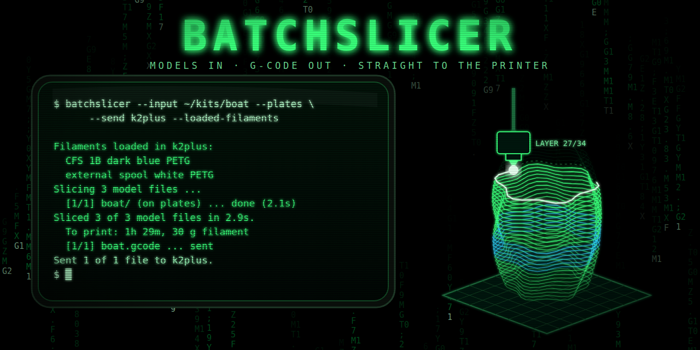

# BatchSlicer User Guide



This guide takes you from installing BatchSlicer to slicing whole folders,
printing in several colours and sending G-code to your printer, one step at a
time. Every step builds on the one before, but you can stop after any of them.
For every option and detail, see the [README](../README.md).


**Contents**

1. [Before you start](#1-before-you-start)
2. [Install BatchSlicer](#2-install-batchslicer)
3. [Let BatchSlicer find your slicers](#3-let-batchslicer-find-your-slicers)
4. [Slice your first model](#4-slice-your-first-model)
5. [Save your choices as a profile](#5-save-your-choices-as-a-profile)
6. [Slice a whole folder, and put kits on plates](#6-slice-a-whole-folder-and-put-kits-on-plates)
7. [Send the G-code to your printer](#7-send-the-g-code-to-your-printer)
8. [Print in several colours](#8-print-in-several-colours)
9. [Slice whatever you drop into a folder](#9-slice-whatever-you-drop-into-a-folder)
10. [Find your results](#10-find-your-results)
11. [When something goes wrong](#11-when-something-goes-wrong)
12. [Quick reference](#12-quick-reference)

---

## 1. Before you start

You need:

- **A Linux computer** with Python 3.12 or newer (`python3 --version` shows it).
  Windows and macOS are not supported yet.
- **At least one slicer** installed: OrcaSlicer, Bambu Studio or Creality
  Print. An AppImage in `~/Apps`, `~/Applications` or `~/Downloads` is fine.
- **The slicer opened once**, with your printer added and the filaments you use
  made visible. BatchSlicer uses the printers, filaments and settings
  ("presets") you set up there, including your own; it never changes them.

To send G-code to a printer you also need a printer running **Klipper with
Moonraker** (such as the Creality K1 and K2 series) or an **OctoPrint** server,
on the same network.

## 2. Install BatchSlicer

The easiest way is [pipx](https://pipx.pypa.io), which installs command-line
tools in their own space:

```bash
sudo apt install pipx        # Debian, Ubuntu, Mint; see the pipx site for others
pipx ensurepath              # then open a new terminal
pipx install batchslicer
batchslicer --version
```

Later, `pipx upgrade batchslicer` updates it.

## 3. Let BatchSlicer find your slicers

```bash
batchslicer setup
```

Setup looks for your slicers and their settings folders, shows what it found,
and asks which copy to use when you have several. It writes the configuration
to `~/.config/batchslicer/config.yaml` and creates two folders:

- `~/BatchSlicer/incoming`: where BatchSlicer looks for models first;
- `~/BatchSlicer/output`: where the G-code goes.

If a slicer says "found ..., but it has not been opened yet", open it once, add
your printer, close it, and run `batchslicer setup` again.

Check that everything works:

```bash
batchslicer doctor
```

It ends with "No problems found." or tells you what to fix.

## 4. Slice your first model

Put a model (`.stl`, `.3mf` or `.obj`) into `~/BatchSlicer/incoming`, then
run:

```bash
batchslicer
```

BatchSlicer asks one question at a time:

1. **The slicer**, if you set up more than one.
2. **The printer, filament and process** (print settings), from the same
   lists your slicer shows. Your own presets come first, marked `(mine)`.
   Type a number to pick one, or type a few letters (`petg`, `0.2`) to shorten
   the list.
3. **Another printer?** Press Enter for no.
4. **What to slice**: choose *One model file*, then pick your model.
5. **Copies**: for a single STL, OBJ or STEP file, how many of this part
   (Enter for 1).
6. **Send to a printer?** Only asked once you have a printer set up (step 7);
   choose 0 to not send.
7. **The output folder**: press Enter for the default.

Then it slices and shows the result:

```
Sliced bracket.stl in 2.4s:
  /home/you/BatchSlicer/output/bracket-20261123-101500/bracket.gcode
  To print: 1h 12m, 18 g filament, filament cost 0.36
```

The G-code is ready for your printer, with a preview picture its screen can
show. Press Ctrl+C at any question to stop without slicing.

## 5. Save your choices as a profile

Answering the same questions every time gets old. Every run is remembered, so
the quickest repeat is:

```bash
batchslicer --last
```

To keep a set of choices under a name, add `--save-profile` to a run:

```bash
batchslicer --save-profile k2-petg
```

A profile remembers everything you chose, including what you sliced and the
output folder, so `batchslicer --profile k2-petg` repeats that run without
asking. Anything you type on the command line wins over the profile, so the
usual way to slice something new with the same settings is to add `--input`:

```bash
batchslicer --profile k2-petg --input ~/BatchSlicer/incoming/wheels
batchslicer --list-profiles
```

With a profile and `--input`, nothing needs to be asked, so BatchSlicer can run
from a script: add `--no-prompt` to make sure it never waits for an answer.

## 6. Slice a whole folder, and put kits on plates

Point BatchSlicer at a folder and it slices every model in it and its
subfolders, keeping your folder names:

```bash
batchslicer --profile k2-petg --input ~/BatchSlicer/incoming/rc-boat
```

Interactively, choose *Every model in a folder* in step 4.

**Zip files work too.** A kit downloaded from a model site can be sliced
without unpacking it yourself: `--input ~/Downloads/rc-boat.zip`. Only its
models are taken out, into a temporary folder that is removed afterwards.

**Kits on plates.** A kit of small parts usually prints best together. With
`--plates`, the loose models (STL, OBJ, STEP) of each folder are arranged on
as few plates as they fit, one G-code file per plate:

```bash
batchslicer --profile k2-petg --input ~/BatchSlicer/incoming/rc-boat --plates
```

Interactively, BatchSlicer asks "Put the models in each folder together on
plates?" when a folder could use it.

A few more options for folders:

- `--exclude "old"` leaves out folders or files whose names match.
- `--orient retry` gives parts that fail ("floating above the bed") a second
  try with the slicer's auto-orient. This rescues many downloaded models.
- `--flat` puts all the G-code in one folder instead of copying your
  subfolders, for printers whose file lists handle folders badly.

A part that fails does not stop the others; the summary at the end says why it
failed, and often which option may fix it.

**Check before a big run.** Add `--dry-run` to see what would happen (which
parts share plates, which filament each uses, where the results would go and
which printer they would be sent to) without slicing anything:

```bash
batchslicer --profile k2-petg --input ~/BatchSlicer/incoming/rc-boat --plates --dry-run
```

## 7. Send the G-code to your printer

**Klipper printers** (Creality K1 and K2, Voron and many others) can be given
their address straight away:

```bash
batchslicer --profile k2-petg --input ~/BatchSlicer/incoming/rc-boat --send 192.168.1.50
```

To give the printer a name, add it to `~/.config/batchslicer/config.yaml`:

```yaml
printers:
  k2plus:
    url: "http://192.168.1.50:7125"
```

Then use `--send k2plus`. The address is the one you open in a browser for
Fluidd or Mainsail, or the one shown in your slicer's device list.

**OctoPrint** always needs an API key: create one in OctoPrint under
*Settings > Application Keys*, then add:

```yaml
printers:
  ender:
    type: octoprint
    url: "http://192.168.1.10:5000"
    api_key: "paste the key here"
```

How sending works:

- BatchSlicer checks that the printer answers **before** slicing.
- A folder keeps its structure on the printer; a file with the same name is
  replaced.
- `--start` starts printing a single model once it is on the printer. It is
  never saved in a profile, and a multi-colour print is never started from
  BatchSlicer: start it on the printer's screen, where you can check which
  spool each colour comes from.
- `batchslicer doctor` checks every printer in the configuration.

## 8. Print in several colours

### Multi-colour 3MF projects

Many downloaded 3MF projects are painted in several colours. BatchSlicer gives
the slicer a filament for every colour, in one of three ways:

1. **Your filament in every slot.** The colours stay as the designer chose;
   your printer's screen asks which spool each colour comes from.
2. **A filament per slot**: repeat `--filament`, slot 1 first:

   ```bash
   batchslicer --profile k2-petg --input bumper.3mf \
     --filament "Black PETG" --filament "White PETG"
   ```

3. **Matched to your Creality CFS** (`--loaded-filaments`, with `--send`).
   BatchSlicer reads what is loaded in the CFS and on the external spool, and
   gives each colour of the project the loaded filament that looks most like
   it:

   ```bash
   batchslicer --profile k2-petg --input bumper.3mf --send k2plus --loaded-filaments
   ```

   ```
   Colours matched to the loaded filaments:
     bumper.3mf:
       slot 1 (black PETG) -> CFS 1B dark blue PETG [Generic PETG @K2 Plus-all]
       slot 2 (white PETG) -> external spool white PETG [Generic PETG @K2 Plus-all]
   ```

   The preview picture shows the real colours, and on a K2 Plus the
   touchscreen's slot-mapping screen already has every colour on the right
   spool.

Interactively, BatchSlicer asks which of the three to use when you slice a
multi-colour project.

### Colour kits made of STL files

Give parts their own colour with `--slot PATTERN=SLOT`; the first matching
pattern wins and everything else uses slot 1:

A single part can be sliced for one spool the same way: `--loaded-filaments
--slot "*=1B"` slices it in that spool's material and colour, and a K2 Plus
then has that spool selected on its slot-mapping screen.

```bash
# lenses in slot 2, the rest in slot 1, all on one plate
batchslicer --profile k2-petg --input ~/kits/jeep --plates \
  --filament "Black PETG" --filament "Clear PETG" --slot "*_lens.stl=2"

# straight from the CFS: lenses from the external spool, the rest from CFS 1B
batchslicer --profile k2-petg --input ~/kits/jeep --plates --send k2plus \
  --loaded-filaments --slot "*_lens.stl=external" --slot "*=1B"
```

`batchslicer doctor` lists what is loaded in each CFS slot.

Good to know:

- Filaments that print at very different temperatures (PLA with PETG) cannot be
  mixed in one print; the slicer refuses, and BatchSlicer says so.
- Use OrcaSlicer or Bambu Studio for 3MF projects: Creality Print's command
  line cannot use your presets with them.

## 9. Slice whatever you drop into a folder

With `--watch`, BatchSlicer keeps running and slices every model, folder or
zip file you drop into the incoming folder, once it has finished copying. A
kit downloaded as a zip can go straight in: its models are unpacked and sliced
like a folder.

```bash
batchslicer --profile k2-petg --plates --send k2plus --watch
```

Each drop is moved into `incoming/sliced/` when done (or `incoming/failed/`),
so you can see what is left. Press Ctrl+C to stop.

**Keep it running in the background**, even without a terminal open:

```bash
batchslicer service install --profile k2-petg --plates --send k2plus
batchslicer service status
batchslicer service uninstall
```

The service starts again whenever you log in. To keep it running after you
log out, and start it when the computer starts, run `loginctl enable-linger`
once.

## 10. Find your results

Every run gets its own folder in `~/BatchSlicer/output`, so nothing is ever
overwritten:

```
output/
  rc-boat-20261123-101500/
    hull/hull.gcode          # one folder per model, like your input
    plates/...               # with --plates
    presets/                 # the exact settings that were used
    report.csv               # print time, filament and cost of every model
    report.json
```

`report.csv` opens in any spreadsheet. For multi-colour prints it also lists
the grams of each filament and the number of filament changes.

## 11. When something goes wrong

1. **Read the summary.** A failed part shows the slicer's own reason, and often
   a hint such as "--orient retry slices them again with auto-orient".
2. **Run `batchslicer doctor`.** It checks the configuration, the slicers, the
   printers and your profiles, and says what to fix.
3. **Look up the message** in the README's
   [Troubleshooting](../README.md#troubleshooting) section.
4. **Still stuck?** [Open an issue](https://github.com/drak42/batch_slicer/issues/new/choose)
   and paste the output of `batchslicer doctor`. BatchSlicer's log, in the
   logs folder `doctor` lists, has the details of every run.

## 12. Quick reference

| I want to... | Command |
|---|---|
| Find my slicers | `batchslicer setup` |
| Check my setup | `batchslicer doctor` |
| Slice, answering questions | `batchslicer` |
| Repeat the last run | `batchslicer --last` |
| Save choices as a profile | add `--save-profile NAME` |
| Use a profile | `batchslicer --profile NAME` |
| Slice a folder | `--input FOLDER` |
| Put each folder's parts on plates | `--plates` |
| Make copies of one part | `--copies 6` |
| Retry failed parts with auto-orient | `--orient retry` |
| Leave some files out | `--exclude PATTERN` |
| All G-code in one folder | `--flat` |
| Send to a printer | `--send NAME` or `--send 192.168.1.50` |
| Start printing one model | add `--start` |
| Use the filaments in my CFS | add `--loaded-filaments` (with `--send`) |
| Give parts their own colour | `--slot "PATTERN=SLOT"` |
| See what a run would do, without doing it | add `--dry-run` |
| Slice what I drop into a folder | `--watch` |
| Keep watching in the background | `batchslicer service install ...` |
| See preset names for scripts | `batchslicer --slicer orca --list-presets` |
| See every option | `batchslicer --help` |

---

BatchSlicer is free and open source. If it saves you time, you can
[buy me a coffee](https://buymeacoffee.com/drak42) ☕.
